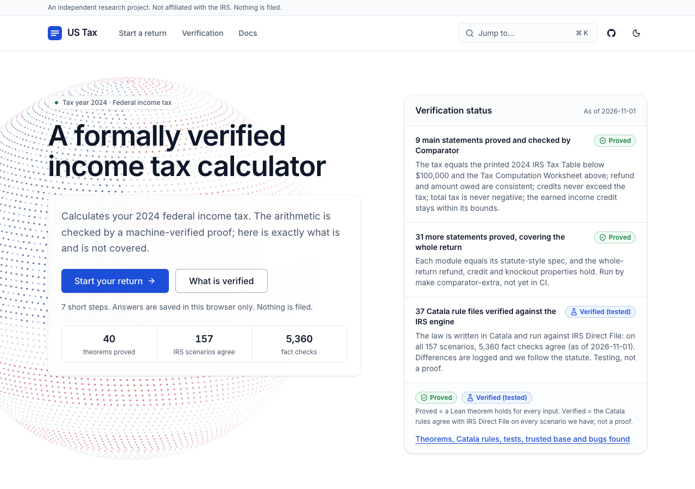
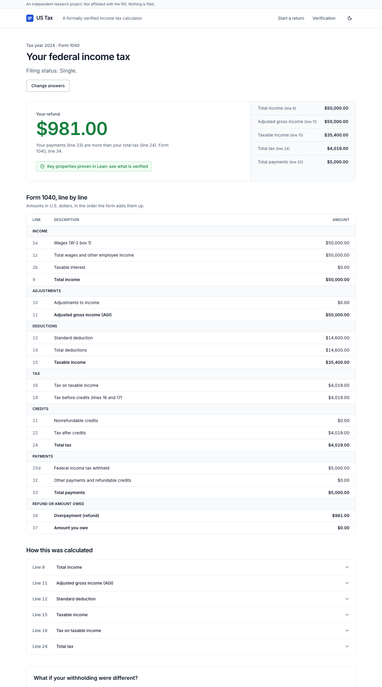
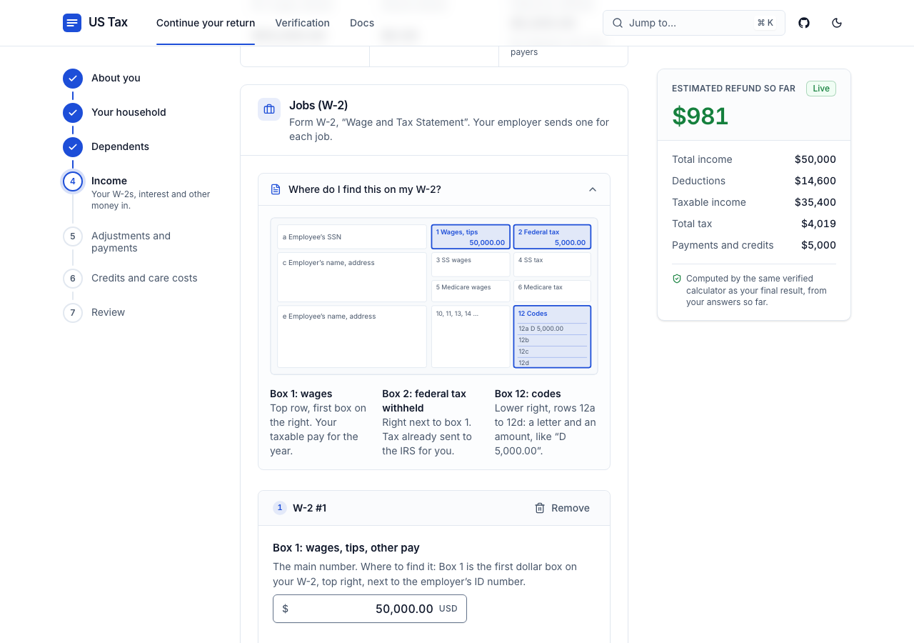
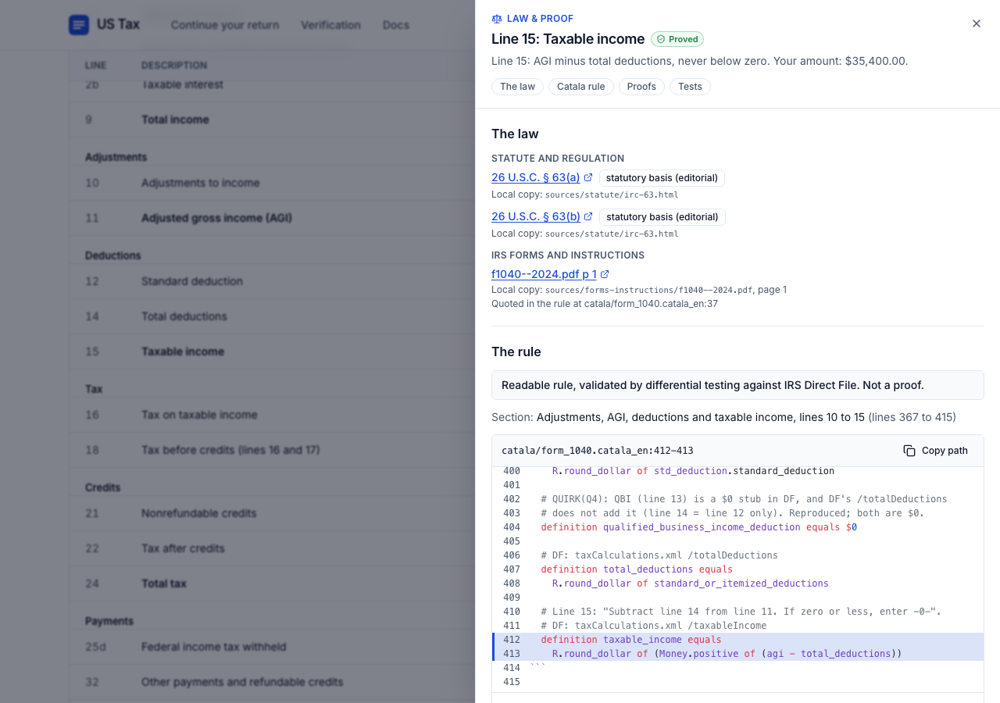
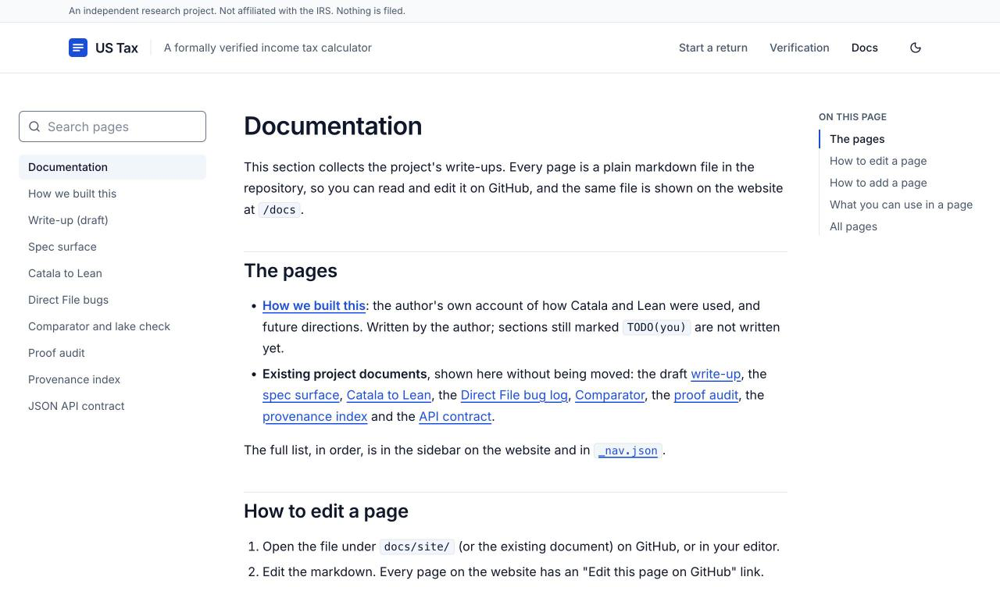
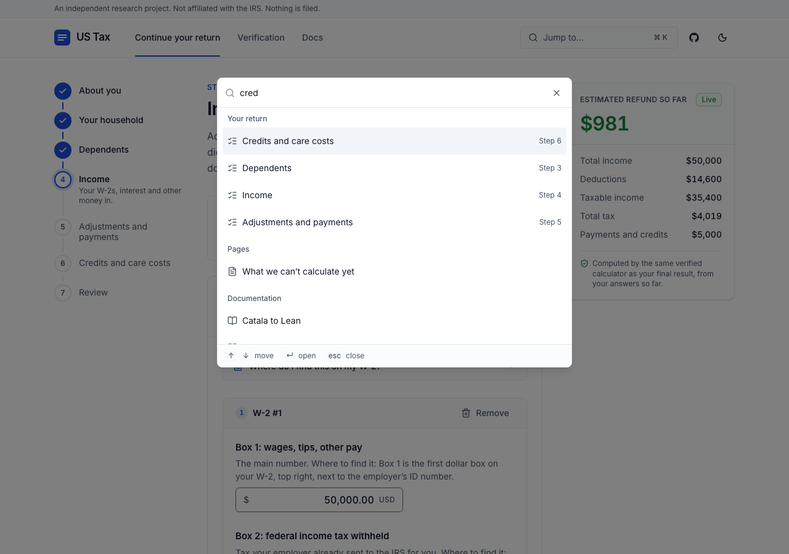

# US Tax

**A US federal income tax calculator for tax year 2024. The tax law is written as readable code,
checked against the IRS's own engine, and the arithmetic is proved in Lean.**

You answer questions about your 2024 return: filing status, household and dependents, W-2s, interest,
unemployment, Social Security, retirement income, adjustments, child care and health insurance.
US Tax works out your Form 1040, line by line, and tells you whether you get a refund or owe money.
Click any line to see the law it comes from, the rule that computes it and the theorems about it.
If your situation is outside what it can handle, it says so plainly instead of guessing.

What makes it different:

- **The law is the code.** The 2024 federal rules are written in [Catala](https://catala-lang.org),
  a language for laws, with the statute and the IRS instructions quoted next to each rule.
  Checking those rules against IRS Direct File, the IRS's own open-source tax engine, turned up
  **33 places where Direct File seems to depart from the law**. One (DF-BUG-8) is confirmed by
  running Direct File's engine; the rest are candidates with a citation and a test.
- **The calculator is written in [Lean](https://lean-lang.org)**, a programming language that is also
  a proof checker. Some promises it makes (for example, "you never get both a refund and a bill") are
  proved for every possible input, not tested on a few. 9 main theorems and 31 more pass Comparator.
- **We say exactly which is which.** See [What is proved, verified, tested and trusted](#what-is-proved-verified-tested-and-trusted).

> US Tax is a research and hackathon project. It does not file anything, and it is not tax advice.

| Home and verification status | Result with the Form 1040 table |
| --- | --- |
|  |  |
| **Wizard with the running estimate** | **Law & proof for line 15: the statute, the Catala rule, the Lean theorems** |
|  |  |
| **Docs inside the app (`/docs`)** | **⌘K command palette** |
|  |  |

More screenshots (every wizard step, dependents, amount owed, an unsupported return, the API
reference, phone width, dark mode) are in [`docs/screenshots/`](docs/screenshots/).

## Try it

You need [devbox](https://www.jetify.com/devbox). Everything else (Lean, Node) is installed
for you inside the project folder.

```sh
curl -fsSL https://get.jetify.com/devbox | bash   # once; or: INSTALL_DEVBOX=1 make install
make install && make run
```

- `make install` downloads the pinned Lean toolchain, builds the calculator and installs the web app.
  The first run takes a few minutes. It does not build Catala, which you only need to run the Catala
  tests: `make install-all` adds it (10 to 20 minutes the first time, compiled from source).
- `make run` starts two things. Press Ctrl-C to stop both.
  - The calculator API at <http://localhost:8080> (`POST /calculate`, `GET /health`, `GET /version`).
  - The web app at <http://localhost:5173>. Open this one.

To try something quick: one wage earner with $50,000 on a W-2 gives a $981 refund. For a fuller
example: married filing jointly, two children, $80,000 wages and $3,000 withheld gives a $1,365 refund
(the child tax credit at work). On every result line, **Law & proof** opens the statute, the Catala
rule and the Lean theorems behind it. Press **⌘K** (Ctrl-K) to jump anywhere. The web app also has a
Verification page, a docs section at `/docs` (the markdown files in [`docs/site/`](docs/site/) and a
few others) and an interactive API reference at `/docs/api`.

Other ways to run it:

- `make server`: only the API, on port 8080.
- `make docker-run`: API on 127.0.0.1:8080 and web app on <http://localhost:8081>, with Docker Compose.
- `make tls`: an HTTPS front on <https://localhost:8443> through Caddy (optional; see [`docs/tls.md`](docs/tls.md)).

## How it works

There are three layers. Each one is checked against the one before it.

```
  The law                IRS forms, instructions, the Internal Revenue Code, Rev. Proc. 2023-34
     |                   (copies in sources/)
     v
  Catala rules           catala/*.catala_en: 37 modules, the rules written next to the legal text.
     |                   Readable by a tax expert. Checked against IRS Direct File. The test oracle.
     |   linked by differential testing (not a proof)
     v
  Lean code + proofs     lean/UsTax: the calculator that actually runs, and the theorems about it.
     |
     v
  Lean web server        lean/ServerMain.lean: plain HTTP on Lean's built-in Std.Http library.
     |
     v
  Web app                web/: React. Asks the questions, shows the result. Holds no tax logic.
```

`POST /calculate` runs the Lean `ApiCalculator` on the whole return: wages, interest, 1099-G,
1099-MISC, 1099-R, Social Security, adjustments, estimated payments, HSA, dependents, the child tax
credit and credit for other dependents (with the additional child tax credit), the earned income
credit, the child and dependent care credit, the saver's credit, the credit for the elderly or
disabled (Schedule R), the premium tax credit, and every knockout. The API contract is
[`docs/api.md`](docs/api.md) (schema 1.2.0, OpenAPI in `api/openapi.json`).

A few words on the tools:

- **[Catala](https://catala-lang.org)** is a language designed for writing laws as code. Its programs
  read a lot like the statute, so a tax expert can check them paragraph by paragraph.
- **[Lean](https://lean-lang.org)** is a programming language with a built-in proof checker. When Lean
  accepts a theorem, a small, well-studied core (the "kernel") has checked every step.
- **Differential testing** means running two programs on the same inputs and comparing every output.
- **IRS Direct File** was the IRS's free filing tool. Its source code is public. We run its tax engine
  on its own 161 test returns and use the results as a third opinion.

Why both Catala and Lean? No Catala-to-Lean translator exists, and writing one would have been a big
job with its own bugs. So the calculator is written directly in Lean, and Catala stays the readable
spec and the test oracle. The reasoning, with measurements, is in
[`docs/catala-to-lean.md`](docs/catala-to-lean.md).

## What is proved, verified, tested and trusted

The full explanation, for non-specialists, is
[What "verified" means here](docs/site/what-verified-means.md) (also on the website at
`/docs/what-verified-means`). In short:

| | What it means | What it covers here | Checked by |
|---|---|---|---|
| **Proved** | A Lean theorem: holds for **every** input | The arithmetic of the Lean calculator that runs: 9 main theorems and 31 more (below), plus request validation | The Lean kernel, `make audit`, `make comparator` |
| **Verified (tested)**: evidence, not proof | The Catala rules agree with IRS Direct File on every test return we have, except where we follow the law on purpose (each case logged) | The tax rules, line by line | `make check` (602 Catala tests), `make difftest` |
| **Tested** | Run on many inputs and compared, not proved | That the Lean code computes what the Catala rules compute; the JSON reader; the HTTP server; the web app | `make lean-difftest`, `make test-server`, `make api-conformance`, `make web-test`, `make e2e` |
| **Trusted** | Assumed correct; nothing here checks it | The Lean kernel, compiler and `Std.Http`; the spec files; the Tax Table data; that the Catala rules mean what the statute means | Human review ([`docs/trusted-base.md`](docs/trusted-base.md)) |

### Proved in Lean

About the Lean code that runs, with no hypotheses beyond the arguments. The statements are in
`lean/UsTax/Comparator/Challenge.lean` (the 9 in [`lean/comparator.json`](lean/comparator.json)), the
properties in `lean/UsTax/Spec/`, and every definition each statement depends on is listed and reviewed
in [`docs/spec-surface.md`](docs/spec-surface.md). In plain words:

- **Line 16 never decreases as taxable income increases**, and is never negative, with filing status fixed
  (`tentativeTax_nonneg_monotone`).
- **Line 16 matches the printed 2024 Tax Table** for every taxable income below $100,000, and the Tax
  Computation Worksheet from $100,000 through $1 trillion (four theorems: `tentativeTax_matches_tax_table`,
  `line16_matches_tax_table`, `tentativeTax_matches_worksheet`, `line16_matches_worksheet`).
- **A refund or a bill, never both**, and refund minus amount owed is exactly payments minus tax
  (`refund_balanceDue_consistent`).
- **Credits can bring your tax down to zero, not below** (`credits_within_liability`), and **total tax
  is never negative** (`totalTax_nonneg`).
- **The earned income credit stays between zero and its legal maximum** (`eitc_within_bounds`).

31 more theorems ([`lean/comparator.extra.json`](lean/comparator.extra.json)) tie the pieces to a plain
reading of the statute (standard deduction, interest, W-2 totals, Social Security, the adjustments) and
cover the whole return the server runs: refund or bill and credits within the tax on the whole return,
`supported = false` exactly when a knockout reason is listed, and **the pure calculator never returns
its internal-inconsistency result**. HTTP and runtime failures remain outside that theorem.
Separately, `Api.parseRequest_sound` proves the server only computes on requests that satisfy the
validity spec. Each of the 40 judged statements has a satisfiable instance and at least two bad outputs
it rejects ([`docs/spec-checks.md`](docs/spec-checks.md)).

`make comparator` and `make comparator-extra` passed on 2026-11-01 (issues #65, #66): Lean's
`lake check` replays the build through the kernel and `lake comparator` checks the proved statements
are exactly the trusted ones, using only `propext`, `Classical.choice` and `Quot.sound`. `make audit`
passed again after the income-domain guard was added: only those three axioms, no `sorry`, no
`native_decide`, and the forensics step checked **7,981 declarations with 0 high-severity findings**
(no vacuous theorems).

### Verified against IRS Direct File

Direct File ships 161 test returns; its engine wrongly knocks out 4 of them (DF-BUG-8, below), which
leaves 157. On 2026-11-01:

- **Catala, whole return** (`make difftest SCOPE=calculator`): 157 of 157 returns, **5,360 of 5,360
  values** agree. 9 values are reported apart as known divergences where we follow the law
  (DF-BUG-3, DF-BUG-23, and one return whose filing status Direct File's own check rejects).
- **Lean, three-way** (Direct File, Catala, Lean; `make lean-difftest SCOPE=calculator`): the same
  5,360 values agree, 0 failures. Through the API request shape (`SCOPE=api_calculator`): **3,105**
  values agree, 0 failures (PR #151).
- **Catala tests**: 602 of 602 pass (`make check`).
- **Server**: `make test-server` 52 passed, 0 failed, 1 skipped (the internal-inconsistency fixture
  cannot be provoked; HTTP/runtime failures are outside the proof); the server equals the command-line
  calculator on 316 requests, including the explicit-birth-date fixture.

Every harness has a **negative control**: with `DIFFTEST_PERTURB=1` or `LEAN_DIFFTEST_PERTURB=1` the
outputs are changed on purpose and the run must fail. It does.

This is strong evidence that the Lean code computes what the Catala rules say. It is not a proof.

## Trusted surface

Everything a proof cannot cover. If one of these is wrong, a result can be wrong even though the
proofs pass. The full list, with the reason for each, is [`docs/trusted-base.md`](docs/trusted-base.md).

- **The Lean kernel, compiler and runtime** (v4.35.0).
- **The spec files a human must review**: `lean/UsTax/Spec/`, the statements in
  `lean/UsTax/Comparator/Challenge.lean` and `Extra.lean`, and `Request.Valid` in
  `lean/UsTax/Api/Spec.lean`, with [`docs/spec-surface.md`](docs/spec-surface.md) as the guide.
  A theorem only means what its statement says. (The owner accepted these files for the hackathon submission without a line-by-line review; see the write-up.)
- **The Tax Table data**, `sources/forms-instructions/derived-tax-table-2024.csv`: derived by us from
  the IRS PDF, not an IRS file. The EIC Table likewise.
- **The Catala rules as a reading of the law.** They quote the statute so a person can check them,
  but no tool checks the meaning.
- **For tests only**: the Direct File engine bundle we run as the oracle (`oracle/README.md`), the
  Catala toolchain 1.3.0, Comparator and its bubblewrap sandbox, devbox/Nix for builds.
- **Caddy**, only if you use the optional HTTPS front.

Accepted axioms: `propext`, `Classical.choice`, `Quot.sound`. No `opaque` contracts, no `axiom`
declarations, no `native_decide`.

### The server's trusted surface (#59)

| Step | Code | Status |
|---|---|---|
| HTTP parsing, sockets | `Std.Http`, `Std.Async` (Lean core) | Trusted; tested by `make test-server` |
| Routing, CORS, body cap, logging | `lean/ServerMain.lean` | Trusted (IO only, no theorem); tested |
| JSON reader | `lean/UsTax/Api/Json.lean` | Tested, not proved (`make api-conformance`) |
| Decode and validate | `lean/UsTax/Api/Parse.lean`, `Validate.lean` | **Proved sound**: every accepted request satisfies `Request.Valid`; every rejection is a 400 |
| Calculate | `lean/UsTax/ApiCalculator.lean` | Lean, with the theorems above; no pure internal-inconsistency result on a valid request (proved); HTTP/runtime failures remain trusted |
| Serialise | `lean/UsTax/Api/Response.lean` | Tested byte for byte against `api/fixtures` |

- Binds `127.0.0.1:8080` by default (`HOST`, `PORT`). CORS allows `http://localhost:5173` by default
  (`ALLOW_ORIGIN`). Bodies over 256 KiB get 413; a non-JSON content type gets 415. Aggregate taxable
  income above $1 trillion gets 400 rather than a capped tax result.
- **No data is stored.** The server logs method, path and status only, never a request body. The web
  app keeps your answers in your own browser's local storage.
- No TLS in the Lean process; see [`docs/tls.md`](docs/tls.md).

### What we did NOT verify

- HTTP framing beyond what `Std.Http` does, and the browser UI.
- The link from the Catala rules to the Lean code: tested on 157 returns, **not proved**.
- That the Catala rules mean what the law means: human reading.
- Tax year 2025 or later, itemized deductions, state taxes.
- Any situation that knocks out: the calculator refuses it and claims nothing about it.

## Bugs we found in the IRS reference implementation

Writing each rule in Catala next to the statute, with Direct File's configuration open beside it,
turned up places where Direct File disagrees with the law. When that happens we follow the law and
log the difference. **The Catala type checker found none of them**; what it did was make the rules
precise enough to compare line by line (see [What "verified" means here](docs/site/what-verified-means.md)).

The log is [`docs/direct-file-bugs.md`](docs/direct-file-bugs.md): **33 entries**. 25 were found while
encoding the rules, 7 in an earlier survey of the Direct File code, 1 by running its test returns.
The calculator follows the law in 30 of them; for 3 (DF-BUG-2, 4 and 10) it keeps Direct File's
behaviour until the project owner decides ([`docs/quirk-decisions.md`](docs/quirk-decisions.md)).
Every entry is pinned by a test.

- **DF-BUG-8, confirmed by running the Direct File engine.** Direct File checks "is the Form 1099-R
  box 8 percentage zero?" by deleting the characters `0` and `.` from the text and checking whether
  anything is left. Because of how the configuration file is read, the `.` is lost, so `0.00` does not
  look like zero. Direct File then wrongly refuses four of its own test returns. **Discovered by
  Arnab Ghosh.**
- **DF-BUG-5** is read in the engine's source: exact fractions are converted to dollars through 32-bit
  floating point.
- The other 31 are **candidates**: each has a citation and a test, but no one outside the project has
  confirmed them. Examples: every Form 1099-MISC treated as Alaska Permanent Fund income (DF-BUG-9);
  a health insurance policy that starts December 1 never counting December (DF-BUG-31).

## Project layout

| Folder | What is in it |
|---|---|
| `catala/` | The rules in Catala, one module per form or topic, with tests in `catala/tests/` |
| `lean/` | The Lean calculator (`UsTax/`), specs (`UsTax/Spec/`), proofs (`UsTax/Proofs/`), web server (`ServerMain.lean`); see [`lean/README.md`](lean/README.md) |
| `web/` | The React web app |
| `api/` | The JSON contract between web app and server: schema, OpenAPI, examples, fixtures, provenance index |
| `oracle/` | Values from the Direct File engine on its test returns (`facts.csv`) |
| `difftest/` | The differential-testing harness (Catala vs Direct File, and Direct File vs Catala vs Lean) |
| `sources/` | The law: forms, instructions, statute, revenue procedures |
| `scripts/`, `deploy/` | Install, run, audit, Docker, Caddy, and the Comparator container |
| `docs/` | Design notes; start with [`docs/writeup.md`](docs/writeup.md) |
| `docs/site/` | Pages shown on the website at `/docs` (see [`docs/site/index.md`](docs/site/index.md)) |
| `docs/screenshots/` | Screenshots of the app |

## Running the checks

Every command runs inside devbox automatically. Commands marked (Catala) need `make install-all`.

| Command | What it does |
|---|---|
| `make check` | (Catala) Type-check all Catala rules and run their tests |
| `make difftest SCOPE=calculator` | (Catala) Compare the whole-return Catala rules with Direct File, scenario by scenario (`SCOPE=all` for every module) |
| `make lean-difftest SCOPE=<name>` | (Catala) Three-way comparison: Direct File, Catala, Lean. `<name>` is a file in `difftest/mappings/`, for example `calculator` or `api_calculator` |
| `make lean-build` | Build the Lean library, including all proofs |
| `make audit` | Fail on `sorry`, `admit`, `native_decide`, new axioms, or theorems that are vacuous |
| `make comparator` | Replay the proofs through the kernel and check them against the trusted statements (9 theorems), in a Linux container |
| `make comparator-extra` | The same for the 31 statements in `lean/comparator.extra.json` |
| `make spec-checks` | Check every judged statement has a satisfiable instance and two or more rejected bad outputs |
| `make test-server` | Start the server and run the HTTP integration tests |
| `make api-conformance` | The Lean request validator against `api/schema.json` on about 2,100 generated requests |
| `make provenance-check` | Check the per-line "Law & proof" index (`api/provenance.json`) is current |
| `make web-test` | Web app unit tests |
| `make e2e` | End-to-end test of the web app against the live server |

`make comparator` runs Lean's `lake check` and `lake comparator`, which only work on Linux. On a Mac
it uses Apple's `container` tool (`container system start` once first). See
[`docs/comparator.md`](docs/comparator.md) and [`docs/audit.md`](docs/audit.md).

## How to contribute

- Read [`catala/CONVENTIONS.md`](catala/CONVENTIONS.md) for naming, money and rounding rules, and
  [`CLAUDE.md`](CLAUDE.md) for how we verify Lean code.
- Humans own the specs: `lean/UsTax/Spec/`, `lean/UsTax/Comparator/Challenge.lean`,
  `lean/UsTax/Comparator/Extra.lean`, `lean/comparator.json`, `lean/comparator.extra.json`.
  Changes there need a careful human review, because they change what the proofs mean.
- A change is done when `make check`, the relevant `make difftest` / `make lean-difftest`, `make audit`
  and `make comparator` all pass.
- If you find a place where Direct File disagrees with the law, add a row to `docs/direct-file-bugs.md`.

The roadmap is [issue #1](https://github.com/arniber21/ustax/issues/1).

## Limitations

- **Tax year 2024 only**, and **federal only** (no state returns).
- **Standard deduction only.** No itemized deductions.
- **Only what Direct File covered**: wages, interest, unemployment, Social Security, some retirement
  income, the common adjustments and credits, and the premium tax credit. See [`scope.md`](scope.md).
- **Some situations are "knocked out"**: the calculator stops and tells you it cannot handle them,
  as Direct File did. The list is in [`docs/knockout-inventory.md`](docs/knockout-inventory.md).
- The American opportunity (education) credit is `$0`, as in Direct File, until the owner decides
  (DF-BUG-2).
- **Not tax advice.** Check your real return with the IRS or a professional.

## License and credits

- **License:** MIT, see [`LICENSE`](LICENSE).
- IRS Direct File is US-government work in the public domain, with a CC0 1.0 waiver. We use its rules,
  test returns and engine as a reference.
- [Catala](https://github.com/CatalaLang/catala) is Apache-2.0.
- Lean and its standard library are Apache-2.0. We also use Batteries and plausible.
- Built by Arnab Ghosh with an orchestrated team of AI agents; see [`docs/writeup.md`](docs/writeup.md)
  for how.
